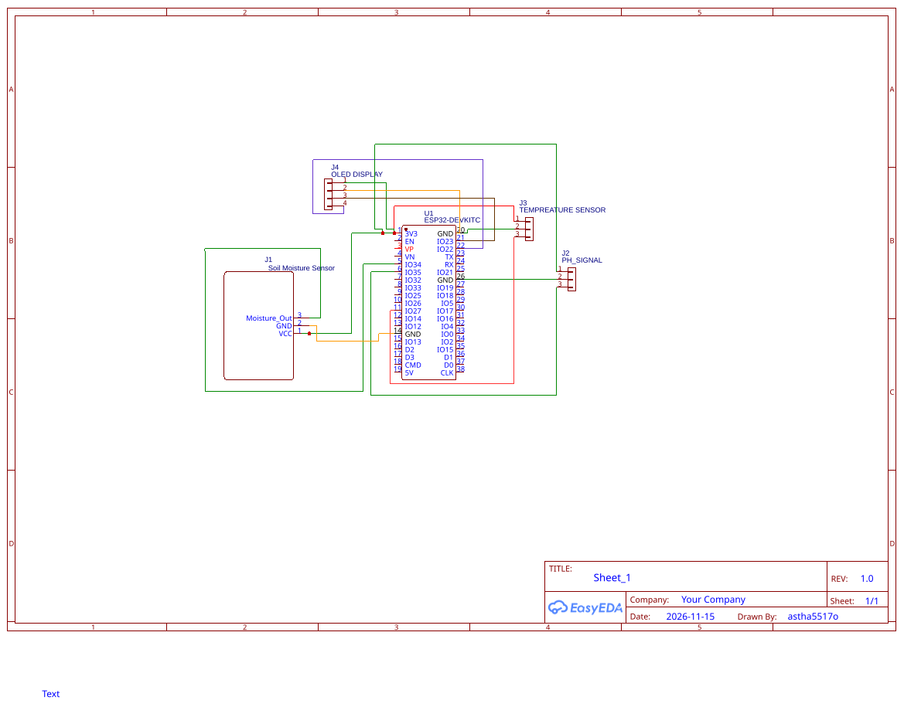

# SMART SOIL – Soil & pH Advisory System

I am working on SMART SOIL to help with one common farming problem: deciding when the soil actually needs water. A fixed watering routine may not work for every crop, season or soil condition. Too much or too little water can affect plant growth and soil quality.

My idea is to place sensors near the plant roots and collect soil readings. The ESP32 will process the sensor readings and send them to a phone through Bluetooth Low Energy (BLE). The phone app is planned to show the readings and give simple irrigation and soil-care suggestions.

## What I am trying to build

- Soil moisture monitoring using a capacitive soil moisture sensor.
- Temperature monitoring using a waterproof DS18B20 probe.
- Soil pH measurement using an external analog pH interface and probe (hardware selection and testing are still pending).
- OLED display for local readings.
- LED and buzzer alerts.
- A phone app for viewing readings and getting suggestions.
- Future app features for crop identification and scanning Soil Health Card / NPK reports.

The app features that use AI are planned software features. The current PCB does not contain a separate AI chip, and the device does not directly measure NPK.

## Why I started this

I wanted to make something that can be useful for farmers and also help in avoiding unnecessary irrigation. I first thought about a simple moisture alert device, but later I started adding temperature and pH so that the system can give more context about the soil.

I am still learning electronics and PCB design, so I am documenting the changes and checking the circuit step by step instead of saying that it is already finished.

## Design progress

I used EasyEDA to draw the schematic and create the first PCB layout. I also generated a 3D view to check the placement of the main components.

### Schematic

- [Open schematic PDF](hardware/schematic/Schematic_Smart-soil-and-ai-ph-advisory-system_2026-11-15.pdf)
- [Schematic notes and pending checks](hardware/schematic/README.md)

### PCB

.png)

- [PCB design notes](hardware/Pcb/README.md)
- [Hardware overview](hardware/README.md)
- [Bill of Materials](hardware/BOM.csv)

## Current status

**Design stage — not yet tested as a working prototype.**

The schematic and PCB layout are first versions. The ESP32 board is still awaiting delivery. I still need to confirm its exact footprint, correct the GPIO assignments, finalize the pH interface and add a suitable solar charging and power-management solution.

The current 3D view is a visual preview. It is not proof that the PCB is ready to manufacture. I will update the files after the circuit checks and physical testing.

## Components and project files

The [BOM](hardware/BOM.csv) separates items already ordered from parts that are still required. The hardware folder contains the current schematic and PCB design notes.

## Next work

1. Check the exact ESP32 board and connector footprint after delivery.
2. Correct the schematic and run ERC.
3. Update the PCB and run DRC.
4. Check the 3D model and export the EasyEDA source and Gerber files.
5. Assemble the prototype and test each sensor.
6. Write and test the ESP32 firmware and BLE connection.

I will keep adding the actual design files and test results here as I make progress.
